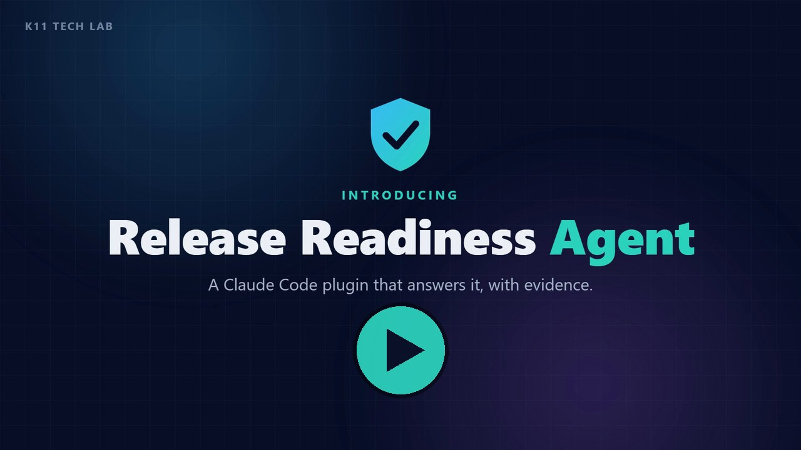

# k11 Release Readiness Agent — Claude Code plugin

**Ask "can we ship this branch?" and get a decision you can defend.**

`/release-readiness:check` works out which checks a change needs, gathers the evidence in parallel with the K11 QA tools, and gets a **deterministic verdict** from the [k11 Release Gate](https://github.com/K11-Software-Solutions/k11techlab-release-gate-mcp):

> 🟢 **ship** · 🟡 **ship with conditions** · 🟠 **needs a person** (named approvers) · 🔴 **block**

The agent plans, runs and explains. **The decision comes from written rules, not from the model,** so the same evidence always gives the same verdict, and every reason points to an evidence file with its SHA-256.

### ▶️ See it in one minute

[](docs/promo.mp4)

*56-second overview: plan, gather evidence with six MCP servers, get a verdict. Click to play, or [download the MP4](https://github.com/K11-Software-Solutions/k11techlab-release-readiness-agent/raw/main/docs/promo.mp4).*

## How it works

```
/release-readiness:check origin/main v2.4.0
        │
        ▼
 1. Plan ─────────── release-gate.plan_checks: changed files → evidence needed
        │            (openapi.yaml → contract + API tests · *.tsx → UI · prompts/** → LLM)
        ▼
 2. Confirm ──────── which test environment and LLM target; never production
        │
        ▼
 3. Gather (parallel sub-agents, only what the change needs)
        ├─ ui-evidence ............ Playwright / Selenium heal-ci (dry run)   → heal-report.json
        ├─ api-contract-evidence .. API Contract QA contract-ci vs base        → contract-report.json
        ├─ api-functional-evidence  API Functional QA run (test env)           → api-test-report.json
        └─ llm-evidence ........... LLM Assure OWASP LLM Top 10 probes          → assessment.json
        │
        ▼
 4. Decide ───────── release-gate.evaluate_release (policy + evidence → verdict)
        │
        ▼
 5. Explain ──────── each blocker, its evidence, the smallest fix; asks before changing anything
```

Each sub-agent produces its report **through the tool's own CLI**, so the evidence is the same as it would be in CI. They use the MCP tools only to investigate failures, for example locator candidates, which consumers break, or reproducing a failing request.

## What's in the plugin

| Part | What it is |
|---|---|
| Skill `check` | The orchestrator: `/release-readiness:check [base ref] [label]` |
| Agent `ui-evidence` | UI tests with self-healing in dry-run mode (Playwright or Selenium, detected) |
| Agent `api-contract-evidence` | Breaking changes and affected consumers vs the base branch (OpenAPI, Swagger, GraphQL, gRPC, AsyncAPI, SOAP) |
| Agent `api-functional-evidence` | API test flows with database checks on the confirmed test environment |
| Agent `llm-evidence` | LLM red-team against the confirmed, authorised target |
| `.mcp.json` | The six K11 servers: Release Gate, Playwright QA, Selenium QA, API Contract QA, API Functional QA, LLM Assure |

## Install

Needs [uv](https://docs.astral.sh/uv/) (for `uvx`) and Node 20+ (for `npx`). Then, in Claude Code:

```text
/plugin marketplace add K11-Software-Solutions/k11techlab-release-readiness-agent
/plugin install release-readiness@k11-release-readiness
```

## Set up your project

The agent works with whatever evidence your project can produce; nothing is mandatory except a release policy:

| To get… | Add |
|---|---|
| A policy | `uvx k11-release-gate-mcp init` → `.qa-mcp/release-policy.yaml` (required kinds, triggers, approvers, rule outcomes) |
| UI evidence | a Playwright or Selenium suite; baselines from `capture_baseline` make healing confident |
| Contract evidence | your API contract file and `.qa-mcp/consumers.yaml` (who calls what) |
| API functional evidence | flows in `tests/api/*.yaml` and `.qa-mcp/api-test.yaml` (environments, auth, test database) |
| LLM evidence | a LLM Assure target file for your chatbot, RAG app or agent |

## Safety

- **Never production:** API tests and red-teaming run only against an environment or target you confirm, and the API tool itself refuses writes on production-like environments.
- **Read-only by default:** healing runs as a dry run; contracts, tests, flows and policies are never edited during a check. The agent asks before any fix.
- **No verdict shopping:** the agent reports the gate's verdict as is and never weakens a test or rule to change it.
- **Secrets** stay in environment variables; every tool masks them in its reports.

## The K11 QA suite

[Playwright QA](https://github.com/K11-Software-Solutions/k11techlab-playwright-qa-mcp) · [Selenium QA](https://github.com/K11-Software-Solutions/k11techlab-selenium-qa-mcp) · [API Contract QA](https://github.com/K11-Software-Solutions/k11techlab-api-contract-qa-mcp) · [API Functional QA](https://github.com/K11-Software-Solutions/k11techlab-api-functional-qa-mcp) · [LLM Assure](https://github.com/K11-Software-Solutions/k11techlab-llm-assurance-toolkit) · [Release Gate](https://github.com/K11-Software-Solutions/k11techlab-release-gate-mcp)

The design follows the K11 research on [risk-proportionate human-in-the-loop control in agentic CI/CD](https://doi.org/10.18535/ijecs/v15i06.5563) (IJECS, 2026): automate the clear cases, and send the uncertain ones to a named person with the evidence attached.

---

Built by [K11 Software Solutions](https://k11softwaresolutions.com). MIT licensed.
